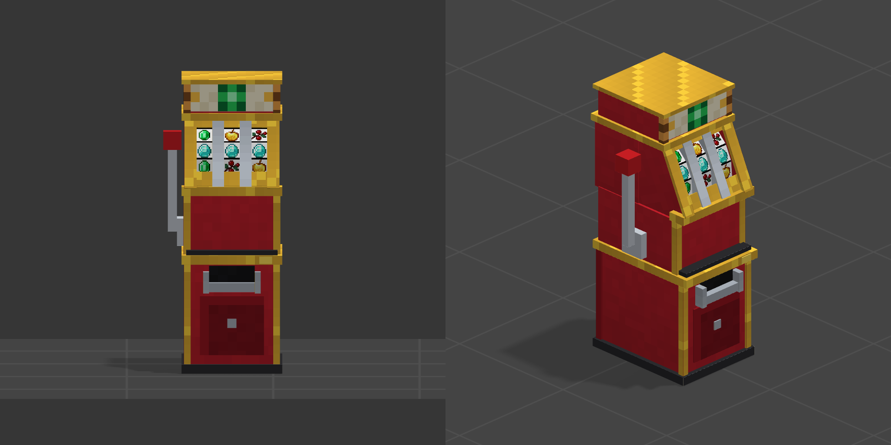
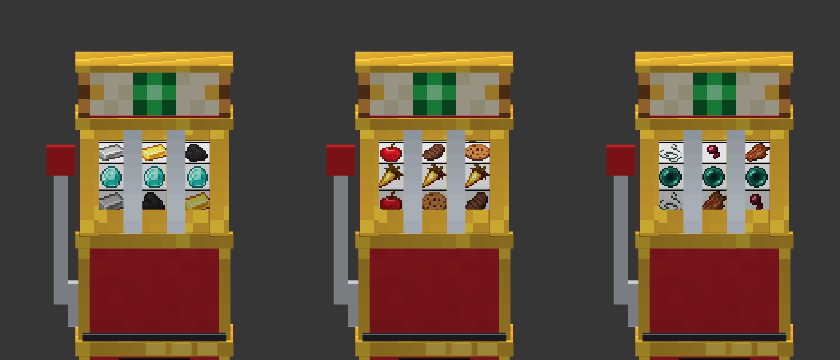

# Slot-Machine Addon

Minecraft Bedrock Edition 専用のアドオンです。スロットマシンを追加します。



## ダウンロード

[最新バージョン](https://github.com/moonstera/Slot-Machine/releases/download/latest/SlotMachine.mcaddon)

## 導入方法

1. [最新バージョン](https://github.com/moonstera/Slot-Machine/releases/download/latest/SlotMachine.mcaddon)から mcaddon ファイルをダウンロードします。
2. ダウンロードしたファイルを開いて、Minecraft に取り込みます。
3. ワールドの設定で、ビヘイビアーパック「スロットマシン」とリソースパック「スロットマシン」を有効にします。**実験的機能は不要です。**

## 動作確認バージョン

- Minecraft Bedrock **26.60 以降**（26.62 で確認）

## v2.0.0 の変更点（v1 から）

### 最新版への対応

- Minecraft 26.60 以降に対応しました。実験的機能（ホリデー クリエイターの特徴、今後のクリエイター機能、ゲームテスト フレームワーク、Molang 機能）はすべて不要になりました。
- スクリプトを新しい Script API（`@minecraft/server` 2.11.0、`@minecraft/server-ui` 2.3.0、どちらも安定版）で書き直しました。

### ブロックに作り直し

- スロットマシンを、エンティティから**縦 2 マスのブロック**に作り直しました。置いた向きに正面が向き、ツルハシで壊すとアイテムに戻ります。賭けていたエメラルドも戻ってきます。
- リール・レバー・ランプの動きは表示専用のエンティティで描いています。リールは滑らかに回り、止めたときに少し揺れます。

### 見た目

- モデルを作り直しました。赤と金の筐体、光る看板、天面の当たりランプ、賭け数ランプ、コイン投入口、払い出し口があります。
- **Vibrant Visuals（PBR）に対応**しました。金や銀の部分は金属の光沢、看板とランプは発光し、周りを暖かい色で照らします。
- リールの絵柄を 4 種類から選べます：**クラシック**（v1 と同じ絵柄）、**鉱石**、**食べ物**、**モンスター**。絵柄ごとにリールの並びも違います（役の数は同じなので、当たりやすさは変わりません）。



### 演出

- 当たると、そろった役のアイテムが筐体のてっぺんから噴水のように弾け飛びます。当たりの大きさで 3 段階に変わります。
  - 当たり：1 回弾けます。
  - 大当たり（2 ライン以上、または 8 点以上）：3 回弾け、花火の音とトーテムのパーティクルが出ます。
  - ジャックポット（最上位の役がそろう、3 ライン以上、または 20 点以上）：6 回弾け、花火が連発し、画面に「ジャックポット！」と出ます。
- エメラルドは音を鳴らしながら少しずつ払い出されます。

### 設定ツール（新機能）

- 設定ツールで台を叩くと、設定画面が開きます。台ごとに次の項目を変えられます。
  - 払い出しの倍率（×0.5〜×10）
  - 最大ベット数（1〜64）
  - リールの絵柄
  - 役ごとの点数
- 「新しく置く台の初期値にする」「最初の設定に戻す」もあります。
- 賭け数ランプは、最大ベット数に対する割合（5 段階）で光ります。

### 保存

- 賭け数・リールの位置・台ごとの設定は、ワールドを閉じても残ります。払い出しの途中でワールドを閉じても、残りは次に開いたときに払い出されます。
- 台とリールは台の位置で結び付けています。コマンドで台だけが消された場合も、リールは自動で消え、賭けていたエメラルドが戻ります。

### v1 からの引き継ぎ

- パックの UUID は v1 と同じなので、ワールドのパックを入れ替えるだけで更新できます。
- ワールドに置いてあった v1 のスロットマシンは、ワールドを開くと自動で回収され、**新しいスロットマシンのアイテム**と**賭けていたエメラルド**としてその場に落ちます。拾って置き直してください。
- インベントリにある v1 のスロットマシンのアイテムは、そのまま新しいブロックとして置けます。
- v1 の「3 回攻撃して回収する」操作は、ツルハシで壊す操作に変わりました。

## 遊び方

プレイするにはエメラルドを賭けます。

| 操作 | 動作 |
|---|---|
| エメラルドを持って使う（右クリック／長押し） | 1 個賭ける（最大は台の設定、初期値 5 個） |
| スニークしながら使う | 賭けたエメラルドを 1 個返す |
| エメラルド以外を持って使う | レバーを引いてリールを回す |
| 回転中に使う | 左のリールから順に止める |
| ツルハシで壊す | スロットマシンを回収する（賭けたエメラルドも戻る） |

3 つ止まると、5 本のライン（上段、中段、下段、斜め 2 本）を判定します。そろったラインの役のポイントの合計 × 賭けたエメラルドの数 × 倍率（初期値 ×1）だけ、払い出し口からエメラルドが出てきます。

役のポイント（初期値。設定ツールで台ごとに変えられます）：

| 順位 | クラシック | 鉱石 | 食べ物 | モンスター | ポイント |
|---|---|---|---|---|---|
| 7 | ネザースター | ネザライトインゴット | ケーキ | 不死のトーテム | 10 |
| 6 | ダイヤモンド | ダイヤモンド | 金のニンジン | エンダーパール | 8 |
| 5 | アメジストの欠片 | ラピスラズリ | パンプキンパイ | 火薬 | 6 |
| 4 | 金のリンゴ | 金インゴット | ステーキ | クモの目 | 5 |
| 3 | エメラルド | 鉄インゴット | リンゴ | 糸 | 4 |
| 2 | スイカ | 銅インゴット | パン | 骨 | 3 |
| 1 | スイートベリー | 石炭 | クッキー | 腐った肉 | 2 |

## 設定ツール

- 入手：クリエイティブインベントリの「装備」、または `/give @s slot_machine:config_tool`（レシピはありません）。
- 使い方：スロットマシンを**叩く**（左クリック／長押しで壊す操作）と設定画面が開きます。ツールで叩いても台は壊れません。
- 設定を変えられるのはオペレーター権限のプレイヤーだけです。

## レシピ

鉄インゴット 8 個でエメラルド 1 個を囲みます（v1 と同じ）。


## 開発者向け

- `tools/themes.py`：リールの絵柄とその並び（スクリプトとテクスチャの共通の表）。
- `tools/gen_models.py`：筐体・アイテム表示・リールのモデルとテクスチャ（PBR を含む）を生成します。絵柄のテクスチャには、環境変数 `VANILLA_ITEMS` で指定したバニラのアイテムテクスチャ（[Mojang/bedrock-samples](https://github.com/Mojang/bedrock-samples) の `resource_pack/textures/items`）を使います。
- `tools/gen_packs.py`：ブロック・エンティティ・アニメーション・パーティクル・言語ファイルなどを生成します。
- `tools/main.ts`：スクリプトの元のコード。`cd tools && npm i && npm run build` で `SlotMachineB/scripts/main.js` を作り直します。
- 作り直す順番（`tools` フォルダで実行）：
  ```bash
  npm i && npx tsc -p .                                   # main.ts -> js/main.js
  VANILLA_ITEMS=<bedrock-samples>/resource_pack/textures/items \
    python3 gen_models.py build ../assets/v1/slot_machine_v1.geo.json ../assets/v1/slot_machine_v1.png
  python3 gen_packs.py build .. out                       # out/SlotMachineB, out/SlotMachineR
  ```
- `assets/v1/`：v1 のリールのモデルと絵柄（クラシックの絵柄の元）。

## ライセンス

[MIT](LICENSE)
